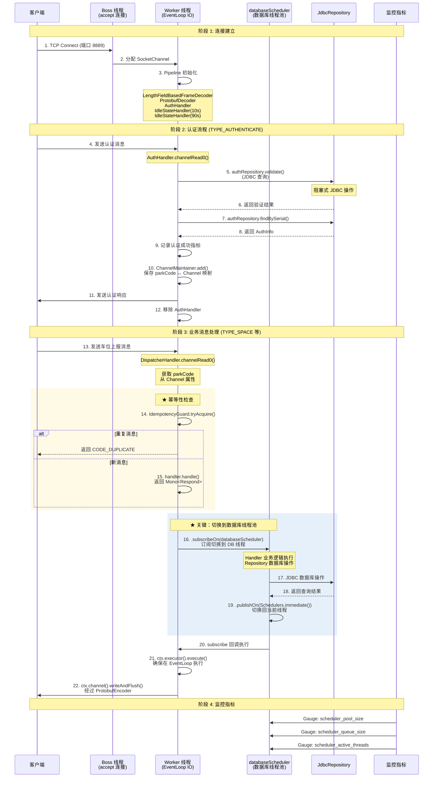

# Parking Netty Framework

停车场 Netty 通信框架 - 基于 Netty 的高性能停车场通信中间件

## 快速导航

| 文档 | 说明 |
|------|------|
| [开发指南](docs/DEVELOPMENT.md) | 开发环境配置、日常开发流程、代码规范 |
| [测试体系](docs/TESTING.md) | 单元测试、集成测试、Docker 测试、Git Hooks |
| [Docker 部署](docs/DOCKER_DEPLOYMENT.md) | 容器化部署、负载均衡、扩缩容 |
| [生产部署](docs/PRODUCTION_DEPLOYMENT.md) | 生产环境部署、监控告警、故障排查 |
| [监控指南](docs/MONITORING.md) | 监控指标、Prometheus、Grafana 仪表板 |
| [响应式架构](docs/RESPONSIVE_ARCHITECTURE.md) | 响应式编程、Reactive Repository |

## 核心特性

- **高性能 TCP 服务器** - Netty 4.1.108.Final，支持万级并发连接
- **Protobuf 序列化** - Google Protobuf 3.25.3，高效二进制序列化
- **完整认证机制** - Serial/Secret 双向认证，支持 Redis/数据库存储
- **心跳检测** - 空闲连接自动断开，资源高效利用
- **消息自动分派** - 基于消息类型的 Handler 路由机制
- **响应式架构** - 基于 Project Reactor，Handler 返回 `Mono<Respond>`
- **分层调度器** - 数据库/外部 API/CPU 计算隔离，支持超时控制
- **消息幂等性** - 基于滑动窗口的消息去重，防止重复处理
- **监控报警系统** - Micrometer + Prometheus + Grafana，实时监控连接数、认证、业务指标
- **分层测试体系** - 快速测试 → 完整测试 → Docker 测试
- **代码质量保障** - JaCoCo 覆盖率 + Checkstyle 代码风格检查
- **Git Hooks** - 提交前自动测试，防止问题代码入库

## 项目结构

```
parking-netty-framework/
├── src/main/java/cn/tnar/parking/
│   ├── NettyApplication.java          # Spring Boot 应用入口
│   ├── config/                        # 配置类
│   │   ├── AuthProperties.java        # 认证配置属性
│   │   ├── RedisProperties.java       # Redis 配置属性
│   │   ├── JdbcProperties.java        # JDBC 配置属性
│   │   ├── JacksonProtobufSupport.java
│   │   ├── NettyProperties.java       # Netty 配置属性
│   │   ├── MetricsConfig.java         # 指标配置
│   │   ├── SchedulerConfig.java       # 调度器配置（响应式）
│   │   ├── SchedulerProperties.java   # 调度器配置属性
│   │   └── SchedulerMetrics.java      # 调度器指标监控
│   ├── framework/                     # 框架核心
│   │   ├── AbstractHandler.java       # 抽象处理器基类（响应式）
│   │   └── IdempotencyGuard.java      # 消息幂等性守卫（滑动窗口去重）
│   ├── netty/                         # Netty 核心
│   │   ├── ApiServer.java             # Netty 服务器
│   │   ├── ChannelMaintainer.java     # Channel 管理器
│   │   └── handler/
│   │       ├── AuthHandler.java       # 认证处理器（响应式）
│   │       ├── DispatcherHandler.java # 消息分派器（响应式）
│   │       ├── DemoHandler.java       # 演示 Handler
│   │       ├── SpaceHandler.java      # 车位上报 Handler
│   │       ├── CarInHandler.java      # 车辆入场 Handler
│   │       ├── CarOutHandler.java     # 车辆出场 Handler
│   │       └── Handler.java           # Handler 接口（响应式）
│   ├── repository/                    # 数据访问层（响应式）
│   │   └── auth/
│   │       ├── ReactiveAuthRepository.java  # 响应式仓库接口
│   │       ├── AuthInfo.java                # 认证信息实体
│   │       ├── InMemoryAuthRepository.java  # 内存实现
│   │       ├── RedisAuthRepository.java     # Redis 响应式实现
│   │       └── JdbcAuthRepository.java      # JDBC 响应式实现
│   ├── web/                         # Web 控制器
│   │   └── AuthRefreshController.java     # 缓存刷新 API
│   ├── task/
│   │   └── HandlerRegistry.java       # Handler 注册表
│   ├── aspect/                        # AOP 切面
│   │   └── MetricsAspect.java         # 指标收集切面
│   └── model/                         # 模型类
│       ├── RespondProto.java          # 响应工厂 (手写)
│       ├── BusinessException.java     # 业务异常
│       └── ExistedFutureException.java
├── prometheus/
│   ├── prometheus.yml                 # Prometheus 配置
│   └── alert_rules.yml                # 告警规则
├── grafana/
│   ├── provisioning/
│   │   ├── datasources/
│   │   └── dashboards/
│   └── dashboards/
├── docker-compose.monitoring.yml      # 独立监控部署
├── src/main/proto/
│   └── message.proto                  # Protobuf 定义
├── src/main/resources/
│   ├── application.yml                # 应用配置（默认 H2 数据库）
│   ├── application-h2.yml             # H2 数据库配置（默认）
│   ├── application-mysql.yml          # MySQL 数据库配置
│   ├── auth.yml                       # 认证配置
│   ├── schema.sql                     # H2 数据库 schema
│   └── schema-mysql.sql               # MySQL 数据库 schema
├── src/test/java/cn/tnar/parking/
│   ├── client/                        # 测试客户端
│   ├── integration/                   # 集成测试
│   ├── netty/handler/                 # Handler 单元测试
│   ├── model/
│   ├── netty/
│   └── task/
├── scripts/
│   ├── start.sh                        # 启动服务器脚本
│   ├── stop.sh                         # 停止服务器脚本
│   ├── build-docker.sh                 # Docker 镜像构建
│   ├── test-all.sh                     # 完整测试套件
│   ├── docker-test.sh                  # Docker 健康检查
│   └── install-hooks.sh                # Git Hooks 安装
├── docker-compose.yml                  # Docker Compose 配置
├── Dockerfile                          # Docker 镜像构建
├── build.gradle                        # Gradle 构建配置
└── README.md                           # 本文档
```

## 核心特性

1. **Netty TCP 服务器** - 基于 Netty 4.1 的高性能 TCP 服务器
2. **Protobuf 序列化** - 使用 Google Protobuf 进行高效序列化
3. **认证机制** - 客户端连接需要先认证 (serial/secret)
4. **心跳检测** - 支持心跳检测和空闲超时断开
5. **消息分派** - 基于消息类型的自动分派处理
6. **Repository 模式** - 认证存储使用 Repository 模式，支持多种实现
7. **配置驱动** - 认证信息通过 auth.yml 配置，支持热更新
8. **AbstractHandler** - 统一的处理器基类，提供日志和异常处理
9. **Spring Boot 集成** - 支持 Spring Boot 自动配置和依赖注入
10. **消息幂等性** - 基于滑动窗口的消息去重，防止重复处理

## 快速开始

### 1. 环境要求

- JDK 21 (Alibaba Dragonwell 21.0.10)
- Gradle 8.5
- Docker 20+ (可选，用于容器化部署)
- H2 Database (默认，嵌入式无需安装)
- MySQL 8.0+ (可选，生产环境使用)
- Redis 6.0+ (可选，生产环境推荐)

### 2. 数据库配置

项目支持 H2（默认）和 MySQL 两种数据库，通过 profile 切换：

```bash
# 使用 H2（默认，无需额外配置）
./gradlew bootRun

# 使用 MySQL
./gradlew bootRun --args='--spring.profiles.active=mysql'
```

或在 `application.yml` 中修改默认配置：
```yaml
spring:
  profiles:
    active: mysql  # 改为 mysql 使用 MySQL，h2 使用 H2
```

### 3. 启动服务器

```bash
# 方式一：使用 Gradle
./gradlew bootRun

# 方式二：使用启动脚本
./scripts/start.sh
```

服务器默认端口：
- HTTP 端口：8080 (Spring Boot Actuator)
- TCP 端口：8889 (Netty)

### 4. 运行测试

```bash
# 快速测试（开发中随时运行）
./gradlew test

# 完整测试套件（提交前运行）
./scripts/test-all.sh

# 查看测试报告
open build/reports/tests/test/index.html
```

### 5. 运行测试客户端

```bash
# 使用 Gradle
./gradlew runClient \
    -PclientHost=localhost \
    -PclientPort=8889 \
    -PclientSerial=TEST-001 \
    -PclientSecret=test-secret
```

### 6. Docker 部署

```bash
# 构建并启动
./scripts/start.sh

# 查看状态
docker compose ps

# 查看日志
docker compose logs -f
```

详细部署文档：[docs/DOCKER_DEPLOYMENT.md](docs/DOCKER_DEPLOYMENT.md)

## 验证连接

客户端成功连接后，会依次发送：
1. 认证消息 (TYPE_AUTHENTICATE)
2. Demo 消息 (TYPE_DEMO)
3. 车位上报消息 (TYPE_SPACE)
4. 车辆入场消息 (TYPE_CAR_IN)

服务端日志示例：
```
AuthHandler received message type: TYPE_AUTHENTICATE
parkCode : PARK001  认证成功，响应已发送

接收消息，parkCode : PARK001, msgType : TYPE_DEMO
DemoHandler 处理消息，parkCode: PARK001, ID: 1001

SpaceHandler 接收车位上报，parkCode: PARK001, 总车位：100, 剩余车位：50

CarInHandler 接收车辆入场，parkCode: PARK001, 车牌：陕 A12345, 通道：ENTRANCE-01
```

## 测试体系

本项目提供分层测试策略，确保代码质量：

| 测试层级 | 命令 | 执行时间 | 用途 |
|----------|------|----------|------|
| 快速测试 | `./gradlew test` | ~5 秒 | 开发中随时运行 |
| 完整测试 | `./scripts/test-all.sh` | ~30 秒 | 提交前验证 |
| Docker 测试 | `./scripts/docker-test.sh` | ~60 秒 | 部署前验证 |

### 测试覆盖

- **单元测试**: RespondProtoTest, HandlerRegistryTest, ChannelMaintainerTest, OperationResultFutureTest
- **Handler 测试**: SpaceHandlerTest, CarInHandlerTest, CarOutHandlerTest, DemoHandlerTest
- **集成测试**: AuthIntegrationTest

### 代码质量

- **JaCoCo**: 代码覆盖率报告 (`build/reports/jacoco/test/html/index.html`)
- **Checkstyle**: 代码风格检查 (`build/reports/checkstyle/main.html`)

### Git Hooks

安装 pre-commit hook，提交前自动运行测试：

```bash
./scripts/install-hooks.sh
```

详细测试文档：[docs/TESTING.md](docs/TESTING.md)

## 添加自定义 Handler

1. 实现 `Handler` 接口:

```java
@Component
public class MyHandler implements Handler {
    @Override
    public Respond handle(Transmission transmission, String parkCode) {
        // 处理逻辑
        log.info("处理消息，parkCode: {}", parkCode);
        return RespondProto.success();
    }

    @Override
    public Transmission.MessageType processedType() {
        return Transmission.MessageType.TYPE_DEMO;
    }
}
```

2. Spring 会自动通过 `HandlerRegistry` 注册到消息分派器

详细开发指南：[docs/DEVELOPMENT.md](docs/DEVELOPMENT.md)

## Protobuf 编译

```bash
# 编译 proto 文件生成 Java 类
./gradlew generateProto

# 完整构建
./gradlew build
```

生成的 Java 类位于：`build/generated/source/proto/main/java/cn/tnar/parking/model/`

## 配置说明

### 数据库配置（Profile 切换）

项目支持 H2（默认）和 MySQL 两种数据库，通过 profile 切换：

```yaml
# application.yml
spring:
  profiles:
    active: h2  # 可选值：h2 | mysql
```

**切换方式**:
- 修改 `application.yml` 中的 `spring.profiles.active`
- 或命令行启动：`--spring.profiles.active=mysql`

**Profile 配置文件**:
- `application-h2.yml` - H2 嵌入式数据库（默认）
- `application-mysql.yml` - MySQL 数据库（生产环境）

### application.yml

```yaml
server:
  port: 8080

netty:
  tcp:
    port: 8889           # TCP 监听端口
    auth-timeout: 10     # 认证超时时间 (秒)
    heartbeat-interval: 90  # 心跳间隔 (秒)
    backlog: 128         # 连接队列大小

logging:
  level:
    cn.tnar.parking: DEBUG
    io.netty: INFO

management:
  endpoints:
    web:
      exposure:
        include: health,info
```

### 认证配置

认证信息通过 `auth.yml` 配置：

```yaml
auth:
  entries:
    - serial: TEST-001
      parkCode: PARK001
      secret: test-secret
    - serial: PROD-002
      parkCode: PARK002
      secret: prod-secret-xyz
```

### 认证存储配置

支持三种认证存储方式（响应式架构）：

```yaml
auth:
  storage:
    type: in-memory  # in-memory | redis | jdbc
    admin-token: change-me-in-production
  redis:
    host: localhost
    port: 6379
    key-prefix: 'parking:auth:'
  jdbc:
    url: jdbc:mysql://localhost:3306/parking
    username: root
    password: xxx
    table: auth_info
```

**存储类型说明**:
- `in-memory`: 内存存储，开发/测试环境使用
- `redis`: Redis 响应式存储，生产环境推荐
- `jdbc`: MySQL 数据库存储，备用方案

**Redis 条件化加载**:

Redis 配置使用 `@ConditionalOnProperty` 按需加载：
- 当 `auth.storage.type=redis` 时，加载 `RedisAutoConfiguration` 和 `RedisRepositoriesAutoConfiguration`
- 当 `auth.storage.type=in-memory` 或 `jdbc` 时，不加载 Redis 相关配置类
- 测试覆盖：`RedisConnectionConfigInMemoryTest` (3 个测试) 和 `RedisConnectionConfigRedisTest` (5 个测试)

**服务启动自动加载** (redis 模式):
服务启动时自动从数据库加载认证数据到 Redis 缓存

**刷新缓存 API** (仅 redis 模式):
```bash
curl -X POST -H "X-Admin-Token: your-token" http://localhost:8080/api/auth/refresh
```

**响应示例**:
```json
{
  "code": 1,
  "message": "success",
  "data": {
    "refreshed": 5
  }
}
```

**Spring Boot 3.x 迁移说明**：
- `@PostConstruct` / `@PreDestroy`: 从 `javax.annotation` 迁移到 `jakarta.annotation`

### 配置项说明

| 配置项 | 默认值 | 说明 |
|--------|--------|------|
| server.port | 8080 | HTTP 端口 (Actuator) |
| netty.tcp.port | 8889 | TCP 端口 |
| netty.tcp.auth-timeout | 10 | 认证超时时间 (秒) |
| netty.tcp.heartbeat-interval | 90 | 心跳间隔 (秒) |
| netty.tcp.backlog | 128 | 连接队列大小 |
| auth.entries | - | 认证列表 (serial/parkCode/secret) |

**注意**: Spring Boot 3.x 使用 Jakarta EE 9+，包名从 `javax.*` 迁移到 `jakarta.*`。

## 线程池架构

### 线程池配置

| 线程池 | 用途 | 核心线程 | 最大线程 | 队列容量 | 拒绝策略 |
|--------|------|----------|----------|----------|----------|
| **databaseScheduler** | Handler 业务逻辑 + JDBC 数据库操作 | 10 | 20 | 1000 | CallerRuns |
| **externalScheduler** | 外部 API 调用（预留） | 5 | 10 | 500 | CallerRuns |
| **cpuScheduler** | CPU 密集型计算（预留） | CPU 核心数 | CPU 核心数×2 | - | - |

### 过载保护

当线程池队列满时，新请求返回 `CODE_BUSY` 响应码，防止系统崩溃：

```protobuf
enum RespondCode {
  CODE_BUSY = 8;  // 服务器繁忙，请稍后重试
}
```

详细设计：[线程池过载保护设计](docs/superpowers/specs/2026-04-07-threadpool-overload-protection-design.md)

### 消息处理流程



### 关键线程切换点

| 阶段 | 线程 | 说明 |
|------|------|------|
| **连接建立** | Boss → Worker | Boss 只负责 accept，IO 操作交给 Worker |
| **认证阶段** | Worker 线程直接执行 | 认证是轻量级操作，直接在工作线程执行 JDBC |
| **幂等性检查** | Worker 线程 | 在 EventLoop 线程执行，零开销 |
| **业务消息** | Worker → databaseScheduler → Worker | 通过 `subscribeOn()` 切换到 DB 线程池，处理后通过 `publishOn()` 切回 |
| **响应发送** | Worker 线程 | 必须回到 EventLoop 线程，确保经过 Pipeline 编码器 |

**为什么需要 databaseScheduler？**

Netty 的 IO 线程（EventLoop）非常宝贵，如果在 IO 线程中直接执行阻塞的 JDBC 操作，会导致：
1. IO 线程被阻塞，无法处理其他连接
2. 系统吞吐量下降
3. 可能引发雪崩效应

`databaseScheduler` 通过 `subscribeOn()` 将数据库操作卸载到专用线程池，保持 IO 线程的轻量级。

## 消息类型

| 类型 | ID | 说明 |
|------|-----|------|
| TYPE_RESPOND | 1 | 通用响应 |
| TYPE_AUTHENTICATE | 2 | 认证消息 |
| TYPE_SPACE | 3 | 车位上报 |
| TYPE_CAR_IN | 5 | 车辆入场 |
| TYPE_CAR_OUT | 6 | 车辆出场 |
| TYPE_DEMO | 100 | 演示消息 |

## 响应码

| 响应码 | 值 | 说明 |
|--------|-----|------|
| CODE_SUCCESS | 1 | 成功 |
| CODE_FAILURE | 2 | 失败 |
| CODE_DUPLICATE | 3 | 重复（消息幂等性） |
| CODE_MISMATCH | 4 | 不匹配 |
| CODE_NOT_SUPPORTED | 5 | 暂不支持 |
| CODE_OFFLINE | 6 | 离线 |
| CODE_TIMEOUT | 7 | 超时 |
| CODE_BUSY | 8 | 服务器繁忙 |

## 通信协议

### 帧格式

```
+----------------+------------------+
| 长度 (4 字节)     | Protobuf 数据     |
| Little-Endian  |                  |
+----------------+------------------+
```

### 认证流程

1. 客户端建立 TCP 连接
2. 服务端启动认证倒计时 (10 秒)
3. 客户端发送 `TYPE_AUTHENTICATE` 消息 (包含 serial 和 secret)
4. 服务端验证通过，返回 `TYPE_RESPOND` (CODE_SUCCESS)
5. 服务端移除 AuthHandler，客户端移除 ClientAuthHandler
6. 后续消息直接由 DispatcherHandler 分派处理

### 消息结构

```protobuf
message Transmission {
  fixed32     ID      = 1; // 消息 ID
  MessageType type    = 2; // 消息类型
  bytes       message = 3; // 具体消息序列化后的字节
}
```

## 消息幂等性

### 机制说明

防止同一 TCP 连接内重复消息导致的业务异常：

| 维度 | 要求 |
|------|------|
| **范围** | 同一 TCP 连接 |
| **判重键** | `(parkCode, messageId)` 组合 |
| **时间窗口** | 10 秒滑动窗口 |
| **重复响应** | `CODE_DUPLICATE` |

### 工作原理

```
t=0s:  客户端发送 ID=100 → 服务端处理成功
t=5s:  客户端重发 ID=100 → 返回 CODE_DUPLICATE
t=15s: 客户端重发 ID=100 → 服务端处理成功（已超出窗口）
```

### 技术实现

- **IdempotencyGuard**: 使用 Channel Attribute 存储已处理消息 ID
- **DispatcherHandler**: 在消息入口处拦截重复消息
- **滑动窗口清理**: 每 1 秒清理过期记录，避免内存泄漏
- **并发安全**: ConcurrentHashMap.putIfAbsent() 原子操作

### 监控指标

- `parking_netty_duplicates_total` - 重复消息计数
- 标签：`message_type`, `park_code`

详细文档：[DEVELOPMENT.md#5.7-消息幂等性](docs/DEVELOPMENT.md#5.7-消息幂等性)

## 单元测试

```bash
# 运行所有测试
./gradlew test

# 查看测试报告
open build/reports/tests/test/index.html
```

### 测试覆盖

| 测试类别 | 测试类 | 说明 |
|----------|--------|------|
| **核心框架** | `RespondProtoTest` | 响应工厂测试 |
| | `HandlerRegistryTest` | Handler 注册表测试 |
| | `ChannelMaintainerTest` | Channel 管理测试 |
| | `OperationResultFutureTest` | 异步 Future 测试 |
| **Handler 测试** | `SpaceHandlerTest` | 车位上报 Handler |
| | `CarInHandlerTest` | 车辆入场 Handler |
| | `CarOutHandlerTest` | 车辆出场 Handler |
| | `DemoHandlerTest` | 演示 Handler |
| | `AuthHandlerTest` | 认证 Handler |
| **Repository 测试** | `InMemoryAuthRepositoryTest` | 内存认证存储 |
| | `RedisAuthRepositoryTest` | Redis 认证存储 |
| | `JdbcAuthRepositoryTest` | JDBC 认证存储 |
| | `JdbcSpaceRepositoryTest` | JDBC 车位存储 |
| **幂等性测试** | `IdempotencyGuardTest` | 滑动窗口去重（9 个测试） |
| | `DispatcherHandlerIdempotencyTest` | 幂等拦截集成测试 |
| **监控指标测试** | `MetricsAspectDuplicateTest` | 重复消息指标 |
| | `MetricsAspectTest` | 指标收集切面 |
| **集成测试** | `AuthIntegrationTest` | 认证集成测试 |
| **Web 控制器测试** | `AuthRefreshControllerTest` | 缓存刷新 API |

**总计**: 60+ 个测试，100% 通过率

## 依赖

| 依赖 | 版本 | 说明 |
|------|------|------|
| Spring Boot | 3.2.4 | 应用框架 |
| Spring Framework | 6.x | Spring 核心 |
| JDK | 21 (Alibaba Dragonwell 21.0.10) | Java 运行环境 |
| Netty | 4.1.108.Final | TCP 服务器 |
| Protobuf | 3.25.3 | 序列化 |
| micrometer-registry-prometheus | 1.12.4 | Prometheus 指标收集 |
| spring-boot-starter-data-redis-reactive | 3.2.4 | 响应式 Redis |
| mysql-connector-j | 8.x | MySQL 驱动 |
| h2 | 2.2.224 | 嵌入式数据库 |
| testcontainers | 1.19.x | 集成测试 |
| Lombok | - | 代码简化 |
| JUnit | 5 | 测试框架 |

## 故障排查

### 客户端连接失败

1. 检查服务端是否启动：`netstat -tlnp | grep 8889`
2. 检查防火墙设置
3. 确认认证信息 (serial/secret) 正确

### 认证失败

1. 检查 `auth.yml` 中是否配置了对应的 serial
2. 确认 secret 匹配
3. 查看服务端日志中的认证错误信息

### 消息未处理

1. 检查 Handler 是否正确注册到 Spring 容器
2. 确认 `processedType()` 返回的消息类型正确
3. 查看 DispatcherHandler 日志

详细故障排查：[docs/DEVELOPMENT.md](docs/DEVELOPMENT.md)

## 扩展建议

### 生产环境配置

1. **认证存储**：替换为 Redis 或数据库
2. **日志配置**：调整日志级别和输出格式
3. **监控告警**：集成 Prometheus + Grafana

### 添加新消息类型

1. 在 `message.proto` 中添加消息定义
2. 运行 `./gradlew generateProto` 生成 Java 类
3. 在 `Transmission.MessageType` 枚举中添加新类型
4. 创建对应的 Handler 实现
